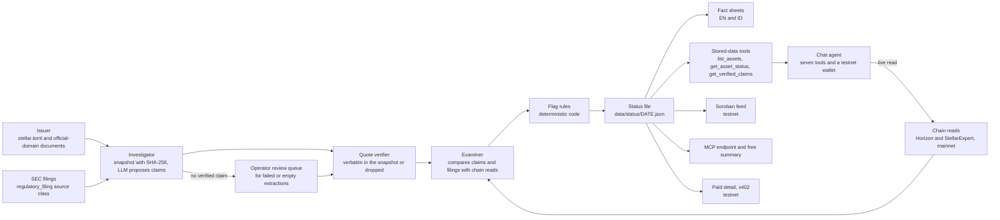

<div align="center">


<h1>Recon</h1>

<p>An AI agent that checks what tokenized real-world asset issuers claim against Stellar on-chain data.</p>

<p>
  
  
  
  <a href="https://recon-agent-opal.vercel.app"></a>
  <a href="https://www.youtube.com/playlist?list=PLdXhc6eJG82E"></a>
  <a href="https://x.com/reconagent"></a>
  <a href="https://github.com/dzakwannajmi/recon"></a>
</p>

<p><b>For judges:</b> progress, proof links, worked examples, and scope are in <a href="agentmaxxing/"><code>agentmaxxing/</code></a>.</p>

</div>

---

## Contents

- [Project description](#project-description)
- [Key features](#key-features)
- [Tools the agent supports](#tools-the-agent-supports)
- [Supported AI models](#supported-ai-models)
- [How it works](#how-it-works)
- [Running locally](#running-locally)
- [Design notes](#design-notes)
- [Roadmap](#roadmap)
- [License](#license)

## Project description

Issuers of tokenized treasuries, funds, bonds, and commodities publish their claims in PDFs and web pages: who the custodian is, what backs the token, when the last attestation was. Comparing those claims with on-chain data is manual work. Lenders and other agents need machine-readable facts, not a prospectus to read.

Recon is an agent that does this comparison. It reads each issuer's `stellar.toml` and official documents, extracts claims with exact quotes, reads Stellar mainnet, and computes flags in deterministic code. It reports facts and flags, never grades. It reads mainnet and writes only to testnet.

The scope is non-stablecoin real-world assets on Stellar: tokenized treasuries, funds, bonds, and commodities. Yield-bearing dollar products such as USDY are in scope and labeled `yield-bearing`. Stablecoins are out of scope. The current universe has 27 assets from six issuers ([`data/assets.csv`](data/assets.csv), status as of 2026-10-18).

## Key features

- **Live mainnet read.** Ask the chat agent about an asset code. It checks the issuer against the official domain pinned for that asset, then reports supply, authorized trustlines, funded holders, and issuer flags.
- **Quote or discard.** Every extracted claim carries the exact quote, source URL, page, and the SHA-256 of the document snapshot. Code drops a claim whose quote is not found in the snapshot.
- **The LLM proposes, code decides.** The model finds, reads, and extracts. Flags and statuses come from deterministic code over stored files. The model never sets a status.
- **Nine flag rules.** Each flag is raised, clear, or not evaluated, with a dated statement and evidence links. Example form: `Mismatch between {document} ({page}) and on-chain {value} as of {date}.` Facts and flags only, no grades.
- **Fact sheets in English and Indonesian.** One page per asset at `/en/assets` and `/id/assets`, built from the newest status file. They need a signed-in account.
- **Issuer identity anchored to `stellar.toml`.** Asset codes are not unique, so each asset is pinned to one `home_domain` with evidence.
- **Issuer documents are untrusted data.** Instructions inside them are never followed. SEC filings are a separate source class, `regulatory_filing`.
- **Operator review queue.** Failed or empty extractions are listed. Reviewed proposals pass through the same verifier.
- **Monitor.** Watches issuer accounts on mainnet for signer and flag changes and for large single-day mints and burns, and re-runs the checks when something happens. It is run on demand today (`npm run monitor`). Its first live run raised a `LARGE_MINT_BURN` flag for gBENJI with the dated statement and a link to the day's sums.
- **7-day hold.** A change to an issuer's authorization flags or signers keeps its flag for seven days after it was first seen. Code decides, not the model.
- **Feed on Stellar testnet.** Lending protocols and other agents read each asset's status, flag bitmask, evidence hash, and as-of time from a Soroban contract the agent's own wallet writes to. Each entry is keyed by the asset's mainnet Stellar Asset Contract id, so that id exists on mainnet and shows as not found on the testnet explorer; only the feed contract itself lives on testnet.
- **Example consumer.** A mock lending market and a keeper that pauses new borrows when the feed reports CRITICAL. The CRITICAL path is shown only on a synthetic, clearly labeled demo feed.
- **MCP endpoint.** Other agents call `check_asset`, `get_fact_sheet`, and `list_flags` at `POST /api/mcp`.
- **Paid evidence with x402 (testnet).** `GET /api/check/detail` returns the full evidence bundle (flags with quotes, source, page and snapshot hash) for a test payment settled on Stellar testnet; it passes the Wasit x402 conformance checks (7 of 7). In the chat, typing `/evidence BB1` pays from the user's own browser wallet and shows a compact view with a green Paid badge and Download JSON and PDF. The model never pays and never sees the bundle. The free summary stays free. The paid rail is on for the live app, on Stellar testnet only.
- **Chat commands without the model.** `/status`, `/flags`, `/claims`, `/check` and `/evidence` answer straight from code and stored data, so they cost no model request.
- **Sign in with GitHub.** The agent chat and the fact sheets need an account. Signed-in users get saved chats (pin, rename, delete), saved paid evidence that reopens without paying again, and thumbs up or down with an optional note. Data is kept in Supabase with row-level security: each row is readable only by its owner, and there is a "Delete my data" action. See [`/privacy`](https://recon-agent-opal.vercel.app/privacy).
- **Testnet agent wallet.** The agent has its own Stellar testnet wallet, funded by Friendbot.
- **Capped LLM spend.** Daily token budget, per-provider request budget per day and per minute, output cap, step limit, and rate limits. Only free-tier API keys are used.

## Tools the agent supports

Seven tools. Every tool is read-only except `fund_my_wallet`, which writes to testnet only. No tool sets a status or moves money.

| Tool | Status | What it does |
| --- | --- | --- |
| `get_my_wallet` | Ready | Get the agent's own Stellar testnet wallet: address, balances, and an explorer link. |
| `fund_my_wallet` | Ready | Fund the agent's testnet wallet with Friendbot (free test XLM). Testnet only. |
| `check_asset` | Ready | Read-only mainnet check of an asset: issuer identity against the pinned official domain, total supply, authorized trustlines, funded holders, flags, and the largest holder's share. Without an issuer, it lists the issuers that use the code and whether each verifies. |
| `list_assets` | Ready | List every tracked asset (non-stablecoin RWAs on Stellar mainnet): code, issuer, organization, type, home domain (from stellar.toml), and the stored status with its as-of date. Stored data, no live reads. |
| `get_asset_status` | Ready | The stored status of one asset from the latest status file: status, as-of date, each raised flag with its exact statement and date, and the fact sheet path. Code computes the status; the model only relays it. |
| `get_verified_claims` | Ready | Claims from an issuer's own documents or regulatory filings (custodian, auditor, net assets, NAV, and more), each with an exact quote that code found verbatim in the document snapshot, the source URL, page, and snapshot SHA-256. Quotes are untrusted issuer text. At most 10 per call. |
| `get_evidence_bundle` | Updated (premium, testnet, user-signed) | Says whether paid detail exists for an asset. It pays nothing and returns no evidence. When it is available, the chat shows an Unlock evidence card and the user pays with a Stellar testnet wallet kept in their own browser (x402, test USDC). The bundle is shown on the page only and is never sent to the model. Typing `/evidence CODE` pays from the same wallet without a click. Off unless the operator switches the x402 rail on. |

## Supported AI models

Models are switchable by environment variables: `LLM_PROVIDER` (`google`, `groq`, `openrouter`, or `nvidia`) and `LLM_MODEL` for chat, and `LLM_EXTRACT_PROVIDER` and `LLM_EXTRACT_MODEL` for claim extraction. Only free-tier keys are used.

Chat models are also switchable by the user: the model selector in the agent's prompt bar lists a fixed server allowlist, limited to providers that have a key on the server. The client sends only an allowlist id; the default is still the `LLM_PROVIDER` and `LLM_MODEL` pair. Every model runs under the same token and request budgets (counted per provider) and rate limits, and there is no silent fallback to another provider. Claim extraction stays pinned and is not selectable.

| Role | Provider | Model | Version note |
| --- | --- | --- | --- |
| Chat (live default) | Google | `gemini-flash-lite-latest` (Gemini Flash-Lite) | Google's alias for the newest Gemini Flash-Lite. The alias can move, so the exact version behind it is not pinned here. |
| Chat (selectable) | Google | `gemini-flash-latest` (Gemini Flash) | Alias, same note. |
| Chat (selectable) | Groq | `openai/gpt-oss-120b` (GPT-OSS 120B) | |
| Chat (selectable) | OpenRouter | `nvidia/nemotron-3-super-120b-a12b:free` (Nemotron 3 Super) | |
| Chat (selectable) | NVIDIA | `nvidia/nemotron-3-super-120b-a12b` (Nemotron 3 Super, NVIDIA) | Checked with tool calling; answers take about 25 seconds. |
| Chat (selectable) | NVIDIA | `nvidia/nemotron-3-ultra-550b-a55b` (Nemotron 3 Ultra, NVIDIA) | Often returns "overloaded" on the free tier. |
| Claim extraction (default) | Google | `gemini-3.7-flash`, thinking level low | Picked by the W2.6 benchmark. |
| Benchmarked, extraction | Google | `gemini-3.5-flash-lite` | Same extraction windows. |
| Benchmarked, extraction | Groq | `openai/gpt-oss-120b` | Same extraction windows. |
| Benchmarked, extraction | OpenRouter | `nvidia/nemotron-3-super-120b-a12b:free` | Same extraction windows. |

Other NVIDIA models (Kimi K2.6, GLM 5.3, DeepSeek V4.1 Flash, Mistral Large 2, Llama 3.1 Nemotron Ultra) were tried and left out: they were not callable with a free key (404) or timed out.

**Benchmark (as of 2026-10-09).** Four free-tier configs ran on the same 15 issuer documents (the OpenRouter config failed on 3 of them and was scored on the other 12), scored against a frozen hand-checked gold set of 50 items, 30 of them verifiable by the current verifier. `gemini-3.7-flash` had the highest precision and recall of the four: precision 83.3% (95% interval 60.8-94.2, n=18 verified claims) and recall 50.0% (33.2-66.8, n=30). The sample is small and one run per config was made, so these numbers describe this 15-document sample only. Scores and runs: [`data/benchmark/scores.json`](data/benchmark/scores.json) and [`data/benchmark/runs/`](data/benchmark/runs/).

## How it works



The Investigator finds documents on the issuer's official domain (the domain whose `stellar.toml` lists the issuer account), snapshots them, and asks an LLM to propose claims. Code keeps a claim only if its exact quote appears in the snapshot. Documents where extraction fails go to a review queue and pass through the same verifier.

The Examiner compares verified claims and filings with Stellar mainnet data. Flag rules are pure functions over the stored evidence, so the same inputs always produce the same status file. Fact sheets are built from that file.

## Running locally

Requires Node.js. From `frontend/`:

```bash
npm install
cp .env.example .env     # add a free Gemini API key (https://aistudio.google.com/apikey)
npm run dev              # http://localhost:3000
npm test                 # unit tests, no network
```

Optional keys in `frontend/.env` (see `.env.example`): `GROQ_API_KEY`, `OPENROUTER_API_KEY`, and `NVIDIA_API_KEY` add models to the selector. Sign-in needs a Supabase project (`NEXT_PUBLIC_SUPABASE_URL` and its publishable key); without them the chat stays open and sign-in is hidden. With them set, the chat and fact sheets need a signed-in user, and `AUTH_REQUIRED=false` turns that off for local work. The paid x402 rail needs the `X402_*` settings from `.env.example` and test USDC on a testnet wallet.

Try it:

1. Open `http://localhost:3000/agent` (or the live app at https://recon-agent-opal.vercel.app/agent) and sign in if asked.
2. Click the example "Check BB1 on Stellar mainnet", then expand the `check_asset` tool call. It shows its input and the raw result: issuer identity, supply, trustlines, flags, and the sources it read.
3. Type `/status USTRY` or `/flags BB1`. These run without the model.
4. Open **Fact sheets** (`/en/assets`, or `/id/assets` in Indonesian), then USTRY and BB1. Each raised flag has a dated statement and links to the evidence behind it.
5. With the x402 rail on and a funded testnet wallet, type `/evidence BB1` to unlock the evidence bundle and download it as JSON or PDF.

Pipeline commands, also from `frontend/`:

| Command | What it does |
| --- | --- |
| `npm run check:assets` | Read-only mainnet check of every asset in `data/assets.csv` -> `data/checks/DATE.json` |
| `npm run snapshot:docs` | Fetch and hash issuer documents -> `data/snapshots/` |
| `npm run extract:claims` | LLM extraction with quote check -> `data/claims/` (`--reverify` runs offline) |
| `npm run benchmark` | Compare Gemini, Groq, and OpenRouter free-tier configs on the same extraction windows -> `data/benchmark/runs/` (`--dry-run` shows the estimate; `--windows`, `--list-models`) |
| `npm run benchmark:score` | Score benchmark runs against the gold set -> `data/benchmark/scores.json` (no network, no LLM) |
| `npm run review:queue` | List extractions that need a human look -> `data/review/queue.json` |
| `npm run import:review` | Import reviewed proposals through the quote verifier (no LLM) |
| `npm run examine` | Examination run -> `data/examinations/DATE.json` |
| `npm run status` | Compute flags and status -> `data/status/DATE.json` (no network, no LLM) |
| `npm run monitor` | Watch issuer accounts on mainnet and re-check when due (`--dry-run` prints the plan and writes nothing); `npm run monitor:demo` shows a simulated event |
| `npm run feed:publish` | Publish a committed status file to the testnet feed (`--dry-run` simulates); `npm run feed:verify` reads every entry back |
| `npm run keeper:demo` | Lending demo on a synthetic feed (testnet) |
| `npm run build` | Build the app and the fact sheets from the newest status file |
| `npm run hooks:install` | Install the tracked pre-commit hook (`core.hooksPath`) that blocks a staged secret-shaped string; it prints the file-list command, never the line |

## Design notes

- **The LLM proposes, code decides.** The model finds, reads, and extracts. Statuses, flags, and feed updates come from deterministic code. A model can be wrong or be manipulated by a document, so it never sets a status.
- **Quote or discard.** Each claim carries the exact quote, source URL, page, and the SHA-256 of the snapshot. A quote must appear exactly once in the snapshot text (only whitespace, typographic quotes, dashes, and PDF ligatures are normalized), and code parses the value from the document's own characters. Raw proposals are stored, so `--reverify` reproduces the result offline.
- **`stellar.toml` is the identity anchor.** Asset codes are not unique (BENJI has 23 issuers on mainnet and USDY 37, as of 2026-10-15). `data/assets.csv` pins one `home_domain` per asset with evidence, and the issuer account must be listed in that domain's `stellar.toml`.
- **Issuer documents are untrusted.** Instructions inside them are never followed. A document is an issuer claim only if it comes from the official domain or a link published there. SEC filings are a separate source class, `regulatory_filing`. Aggregators are for discovery only.
- **Fetching untrusted domains is SSRF-guarded.** A `home_domain` can be set by anyone. Fetches use https, public DNS names only, a checked address at connect time, a redirect limit, a deadline, and a size cap.
- **Flags are pure functions of stored files.** The same stored files always produce the same flags and statuses. Every flag ends as raised, clear, or not evaluated, and raised and clear results carry evidence references. A mismatch statement reads `Mismatch between {document} ({page}) and on-chain {value} as of {date}.` Every statement is a dated fact, with no grades.
- **Operator review goes through the same verifier.** Claims from the review queue are labeled `operator-reviewed`. The review step runs outside the app, and no server route calls it.
- **LLM spend is capped.** A daily token budget that fails closed, an output-token cap, a step limit, a global rate limit, and a per-IP limit when behind a trusted proxy. The limits live in memory and on disk per server instance, so on Vercel the budget is per instance, not global.
- **Sign-in is for the person, not the key.** The browser uses only Supabase's publishable key; there is no service-role key in the app. Saved paid evidence is shown on the page and never sent to the model, because it holds untrusted issuer text.
- **Read mainnet, write testnet.** The agent wallet is testnet-only and funded by Friendbot. Its secret is never returned or logged.

## Roadmap

**Shipped so far**

- **Week 1:** chat agent with a testnet wallet and read-only mainnet checks.
- **Week 2:** document snapshots, claim extraction with the quote verifier, the Examiner, nine flag rules, fact sheets in two languages, the extraction benchmark, and the operator review queue.
- **Week 3:** the Soroban feed contract with the 7-day hold, the feed on testnet, x402 settlement on testnet, the MCP endpoint, and a threat model.
- **Week 4 so far:** the lending keeper demo, the Monitor with a live `LARGE_MINT_BURN` rule, fact sheets with the final flag wording, paid evidence from the chat (typed command, Paid badge, JSON and PDF), commands that run without the model, more chat models, and GitHub sign-in with saved chats, saved evidence and feedback.

**Next**

- **Cited Q&A.** Answers in chat that cite only stored evidence.
- **Report** "State of RWA Transparency on Stellar", with numbers traced to the stored data.
- **Monitor on a schedule,** so re-checks run without an operator.
- **Feed contract upgrade path,** to widen the schema and flag bits through an audited upgrade.
- **More assets** in the universe, and a feed on mainnet once the rules are stable.

## License

MIT. See [LICENSE](LICENSE).
